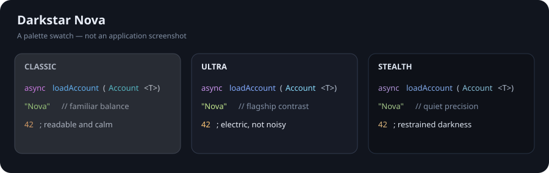

# Darkstar Nova

**The Next Evolution of Darkness.**

Darkstar Nova is an original, cross-platform dark theme family inspired by the readability and balance of One Dark. It brings a shared midnight-blue palette and semantic syntax system to Zed, Xcode, JetBrains IDEs, and macOS Terminal.

> Darkstar Nova is not affiliated with or endorsed by Zed Industries, JetBrains, or the One Dark theme authors. This repository contains no One Dark source code or assets.

## Variants

| Variant | Character | Editor background |
| --- | --- | --- |
| **Classic** | Familiar charcoal-blue with balanced One Dark-inspired syntax | `#282C34` |
| **Ultra** | Flagship midnight navy with bright electric syntax | `#171B26` |
| **Stealth** | Near-black blue with restrained accents | `#0E1118` |



The palette preview is a generated swatch, not a screenshot of an IDE. Application screenshots should be added after manual visual QA in each target app.

## Supported targets

| Platform | Generated deliverables | Validation status |
| --- | --- | --- |
| Zed | Three-theme family JSON and extension manifest | Generated against the Zed theme v0.2.0 field set; visual loading still needs manual confirmation |
| Xcode | Three native `.xccolortheme` property lists | Property-list validation; Xcode 27.1 is installed, but theme import has not been manually confirmed |
| JetBrains IDEs | Theme plugin sources, editor schemes, Gradle build configuration | Source validation; plugin build/install requires JDK 17+ and Gradle 9+ |
| macOS Terminal | Three importable `.terminal` profiles | Generated using AppKit color/font archives and property-list validation; import needs manual confirmation |

The shared tokens describe visual intent. Platform mappings translate semantic roles to each app's native syntax scopes; the scopes are not assumed to be interchangeable.

Zed's current v0.2.0 theme schema has no local-editor caret or text-selection color fields. The Zed output therefore themes supported focus, search, document-highlight, and UI selection colors without emitting unsupported keys; Zed's local caret and text-selection appearance remain app-controlled.

## Installation

### Zed

Install the family with:

```sh
sh install/zed/install.sh
```

For local extension testing, use Zed's **Install Dev Extension** command and select this repository. The theme selector will offer **Darkstar Nova Classic**, **Darkstar Nova Ultra**, and **Darkstar Nova Stealth**. The installer does not edit Zed settings and refuses to overwrite a different file with the same name.

### Xcode

Install all three `.xccolortheme` files with:

```sh
sh install/xcode/install.sh
```

Then select a variant under Xcode Settings → Themes. The installer refuses to overwrite existing files.

### JetBrains IDEs

The installer builds the plugin with JDK 17+ and Gradle 9+, then installs it into the chosen IDE's plugins directory:

```sh
sh install/jetbrains/install.sh "$HOME/Library/Application Support/JetBrains/IntelliJIdea2024.2/plugins"
```

Use the actual plugins directory for your IDE and version; alternatively set `DARKSTAR_NOVA_JETBRAINS_PLUGINS_DIR`. The script refuses to overwrite an existing `darkstar-nova-theme` plugin directory. Restart the IDE after installation. Compatibility is declared for IntelliJ Platform builds 242 and newer; verify against each IDE/product version you ship.

### macOS Terminal

Stage all three profiles with:

```sh
sh install/terminal/install.sh
```

The script prints the staged profile directory. Import the `.terminal` files in Terminal Settings → Profiles. Terminal stores imported profiles in its own preferences, so the installer deliberately does not modify those preferences or change the default profile.

Terminal profiles recolor ANSI output. Shell prompt and syntax colors still depend on the user's shell setup and installed command-line tools.

### Uninstall

Run the global uninstaller:

```sh
sh uninstall.sh
```

It removes files created by these installers only when their contents still match the recorded install checksums. It preserves pre-existing, changed, or untracked files. Profiles already imported into Terminal must be removed manually from Terminal Settings → Profiles.

The installer manifest is stored under `${DARKSTAR_NOVA_STATE_HOME:-${XDG_STATE_HOME:-$HOME/.local/state}/darkstar-nova}`. Keep the same state-home environment when uninstalling if you overrode the default.

## Design tokens

- `design/tokens.json` defines the family, variants, and required token names.
- `design/zed-theme-schema-v0.2.0.json` records the relevant official Zed theme schema fields for offline validation.
- `design/variants/*.json` define each variant's palette.
- `design/syntax.json` maps semantic syntax roles to palette tokens and maps those roles to Zed, Xcode, and JetBrains scopes.
- `generators/` contains platform renderers. Generated files in `themes/` are checked in for direct installation and review.

### Ultra palette

| Role | Color |
| --- | --- |
| Background | `#171B26` |
| Sidebar | `#11151E` |
| Primary text | `#E8EDF7` |
| Keywords | `#C792EA` |
| Functions | `#82AAFF` |
| Strings | `#C3E88D` |
| Types | `#89DDFF` |
| Numbers and booleans | `#FFC777` |
| Constants and decorators | `#FF7AB6` |
| Errors | `#FF647C` |
| Comments | `#8290A5` |

## Development

Requirements: Node.js 20 or newer. The native Terminal profile generator additionally requires macOS and Swift with AppKit.

```sh
npm run build
npm run validate
npm test
```

`npm run build` regenerates platform assets from the design data. It does not install themes, change user preferences, or overwrite installed themes. On non-macOS systems it skips Terminal profile generation; the checked-in profiles can still be inspected as plists.

The previews in `previews/` provide representative TypeScript/TSX, Swift, Rust, and terminal samples for manual visual checks.

## Licence and attribution

Darkstar Nova's original design files and generators are licensed under MIT; see [LICENSE](LICENSE). The project is inspired by One Dark but does not copy upstream code or assets. If a future contribution incorporates material from One Dark or another upstream project, retain that source's required licence and attribution and document the provenance before merging it.

## Changelog

See [CHANGELOG.md](CHANGELOG.md).
